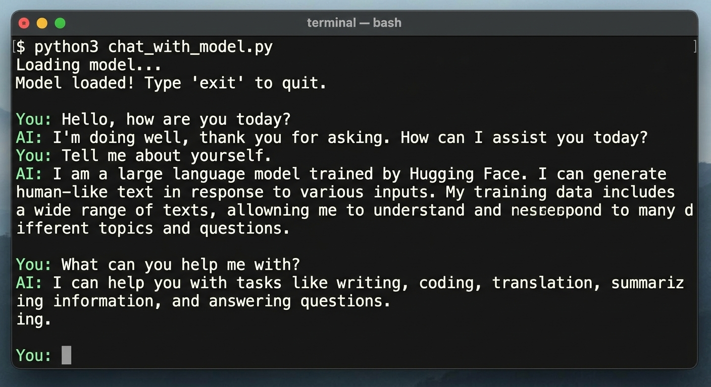

# SmolLM2-135M Local Inference Engine (tiny.py)

## Abstract

This repository contains a lightweight local command-line inference script for running instruction-tuned causal language models directly on your machine. It is designed to be simple, portable, and easy to understand while still demonstrating the core workflow of loading a model, formatting chat history, and generating text with Hugging Face tools.

The project is intended for experimentation with small open models, especially in environments where a GPU is unavailable or where users want to keep workloads local and private. It can be used as a minimal example for learning how transformer-based inference works in practice without the overhead of a larger application framework.

## What this project does

The script demonstrates how to:

- Load a Hugging Face language model with `transformers`
- Run inference using `PyTorch`
- Maintain conversational context across multiple turns
- Apply the tokenizer's chat template for message formatting
- Generate output with top-p sampling and temperature control
- Interact with the model through a basic terminal prompt
  


## Key implementation details

The underlying system relies on the Hugging Face `transformers` and `PyTorch` libraries. Key algorithmic features include:

- Explicit device mapping: the model is forced to run on the host CPU, which helps avoid hardware dependency issues and preserves accelerator VRAM for larger workloads.
- Stateful dialogue management: conversation context is maintained incrementally by appending role-based message dictionaries such as system, user, and assistant.
- Chat template formalization: structured message buffers are serialized into tokenizer-compatible input using the native chat template API.
- Stochastic decoding: the project uses nucleus sampling (`top_p = 0.9`) combined with temperature scaling (`temperature = 0.7`) to balance generation diversity and coherence.

## Use cases

This repository is useful for:

- learning how local inference works for small language models
- experimenting with chat-style generation on modest hardware
- testing prompt behavior in a lightweight CLI
- running a compact model without remote API dependencies

## System requirements

To execute this script, ensure the following Python packages are installed in your environment:

```bash
pip install torch transformers
```

## Execution protocol

1. Clone or download the script as `tiny.py`.
2. Initialize the execution environment from your terminal:

```bash
python tiny.py
```

3. Once the model loads successfully, interact with it through the prompt.
4. End the session by entering `exit` or `quit`.

## Notes

This project is intentionally minimal and educational. It provides a straightforward example of local model execution, but it is not a full production inference stack. For more advanced usage, you could expand it with features like model quantization, streaming output, improved CLI controls, or a web interface.

## Summary

SmolLM2-135M Local Inference Engine is a lightweight, CPU-friendly example of running a small instruction-tuned language model locally. It is a practical project for understanding the fundamentals of transformer inference, tokenization, chat formatting, and text generation in a simple command-line environment.
